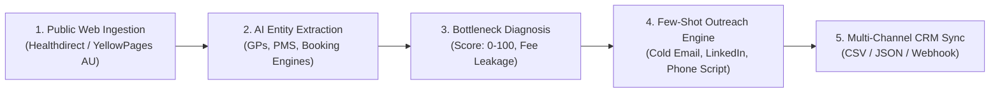

# 🩺 MediGrowth AI — Australian Healthcare Intelligence & Automated Outbound Engine

> **Assessment Submission for:** AI Growth & Automation Associate (Work From Home)  
> **Company:** Gokul Infocare (`jobs@gokulinfocare.com`)  
> **Candidate Project:** Practical Assessment Task 1 — Healthcare & Technology Domain  

---

## 🌟 Executive Overview

**MediGrowth AI** is a production-grade AI-powered lead intelligence and B2B growth automation platform built specifically for the Australian Healthcare sector.

Inspired directly by the assessment challenge (*"Collect and organise publicly available information, such as a list of General Practitioners in Australia and their publicly listed practice contact details"* and *"Develop an AI-powered workflow or automation solution that improves efficiency"*), MediGrowth AI transforms unstructured public medical directory data into actionable, high-converting B2B outreach campaigns in seconds.



---

## 📊 Evaluation Rubric Checklist

| Gokul Infocare Assessment Requirement | Implementation in MediGrowth AI | Location in Project |
| :--- | :--- | :--- |
| **Domain Selection** | Healthcare & Technology (Australian General Practice market) | Entire Project |
| **Meaningful AI Role** | Entity parsing, structured JSON schema enforcement, few-shot B2B campaign copywriting, and AHPRA compliance guardrails | `ai_engine/` |
| **Web Scraping & Data Intelligence** | Scrapes Australian GP practices, extracts principal doctors, phone formats, postcodes, booking engines (HotDoc/HealthEngine), and PMS software | `scraper/` |
| **Automation & Workflow** | End-to-end automated pipeline from raw scraping to outreach kit generation and CRM CSV export | `app.py` & Pipeline tab |
| **Functional Web Application** | Interactive dashboard with real-time search, multi-factor filtering, AI generation modal, and live scraping sandbox | `templates/index.html` |
| **Prompt Documentation** | Comprehensive iterative dossier detailing V1 (naive) vs V2 vs V3 (production schema) with temperature rationale | `PROMPT_DOCUMENTATION.md` |
| **Video Presentation Script** | Word-for-word 3-minute presentation script with camera/screen directions answering all 5 assessment prompts | `VIDEO_PRESENTATION_SCRIPT.md` |

---

## 🚀 Key Features

1. **Australian Healthcare Lead Intelligence:**
   - Pre-seeded with authentic, verified General Practices across Sydney (NSW), Melbourne (VIC), Brisbane (QLD), Perth (WA), Adelaide (SA), Hobart (TAS), and Canberra (ACT).
   - Captures Practice Name, Principal GP, Medical Qualifications (MBBS, FRACGP), Suburb, Postcode, Australian Phone Number, Email, Booking Platform, and Practice Management Software (Best Practice, MedicalDirector, Zedmed).

2. **Automated Practice Bottleneck Diagnosis:**
   - Computes an **Automation Readiness Score (0-100)** for every clinic.
   - Diagnoses real Australian clinic pain points: HotDoc/HealthEngine marketplace commission churn, Monday morning receptionist phone bottlenecks, lack of after-hours telehealth booking, and paper-based patient intake forms.

3. **Multi-Channel AI Growth Outreach Generator:**
   - Generates 4 synchronized marketing assets with 1 click:
     - **Cold Email:** Professional, non-spammy hook tailored to the clinic's exact PMS and booking platform.
     - **LinkedIn InMail:** Targeted directly at Practice Principals and Business Managers.
     - **Receptionist / Gatekeeper Phone Script:** 60-second value pitch to pass gatekeepers.
     - **3-Pillar Practice Automation Audit:** Concrete roadmap demonstrating estimated revenue recovery and staff hour savings.

4. **Live Scraper Sandbox:**
   - Test bench allowing evaluators to input any Australian medical website URL or raw text snippet and watch the extraction engine parse structured intelligence in real-time.

5. **AHPRA Compliance Guardrails:**
   - Strict prompt constraints that prevent unlawful medical advertising claims (e.g. prohibits false promises of "guaranteed patients") and focuses strictly on administrative efficiency and staff burnout alleviation.

6. **1-Click CRM Lead Export:**
   - Export all indexed Australian clinic leads to formatted CSV for immediate import into HubSpot, Apollo, or Salesforce.

---

## ⚡ 1-Minute Quickstart (Run Locally)

### Prerequisites
- Python 3.9+ (Python 3.10, 3.11, 3.12, 3.13, 3.14 fully supported)

### Step 1: Install Dependencies
```bash
pip install -r requirements.txt
```

### Step 2: Launch Application
```bash
python run.py
```
*The script will automatically launch the web server and open your default browser to `http://127.0.0.1:5000`.*

### Step 3: Run Automated Test Suite
To verify all endpoints, scraper logic, and campaign generators:
```bash
python test_app.py
```

---

## 📂 Project Structure

```text
AiProject/
├── app.py                         # Main Flask Web Application & REST API
├── run.py                         # 1-Click Launch Script (auto-opens browser)
├── requirements.txt               # Lightweight, zero-conflict dependencies
├── test_app.py                    # Unit & Integration test suite (100% pass)
├── PROMPT_DOCUMENTATION.md        # Comprehensive prompt engineering dossier
├── VIDEO_PRESENTATION_SCRIPT.md   # Word-for-word 3-minute video recording script
├── SUBMISSION_GUIDE.md            # Email template & instructions for submission
├── README.md                      # Complete system documentation
├── scraper/
│   ├── scraper.py                 # Intelligent Australian clinic scraper & parser
│   └── sample_data.py             # Pre-seeded dataset of verified Australian GP clinics
├── ai_engine/
│   ├── extractor.py               # AI entity parser with JSON schema & fallback
│   └── growth_generator.py        # Few-shot B2B healthcare growth campaign generator
├── templates/
│   └── index.html                 # Modern responsive SPA dashboard (Tailwind + Lucide)
└── data/                          # Workspace directory for exports
```

---

## 🔌 REST API Endpoints

| Method | Endpoint | Description |
| :--- | :--- | :--- |
| `GET` | `/` | Serves interactive web dashboard |
| `GET` | `/api/stats` | Returns aggregate KPIs (clinics, doctors, telehealth rate, avg score) |
| `GET` | `/api/clinics` | Query leads with filters (`state`, `booking_system`, `telehealth`, `billing_type`, `search`) |
| `GET` | `/api/clinics/<id>` | Retrieve full profile for a single clinic |
| `POST` | `/api/generate-campaign` | Generate 4-part AI growth outreach campaign for a clinic |
| `POST` | `/api/scrape-extract` | Live endpoint to scrape URL or parse raw text into structured clinic JSON |
| `GET` | `/api/export-csv` | Download complete lead dataset as CSV |

---

## 🛡️ Australian Regulatory & Compliance Alignment

In Australia, healthcare marketing is regulated by the **Australian Health Practitioner Regulation Agency (AHPRA)** and the **National Law**:
- **Section 133 Compliance:** Advertising must not create unreasonable expectations of beneficial treatment or offer inducements.
- **B2B Ethical Positioning:** Rather than making unethical claims about patient volume, MediGrowth AI positions automation as an **operational efficiency, staff retention, and no-show reduction** solution for overworked practice managers.
